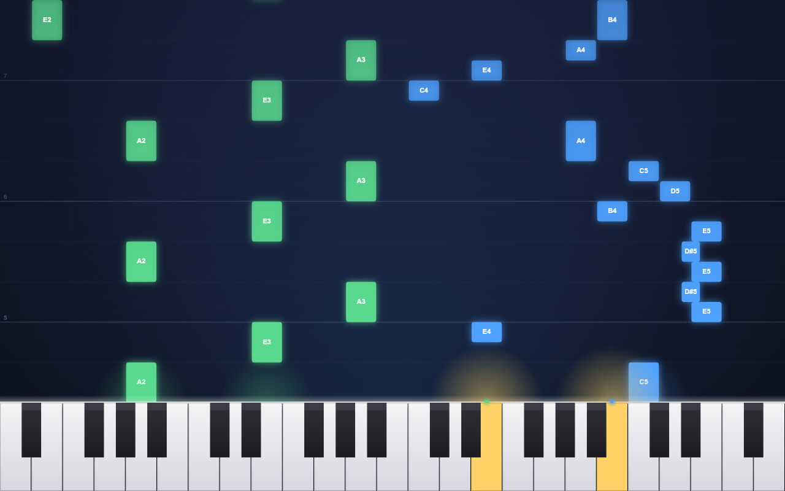
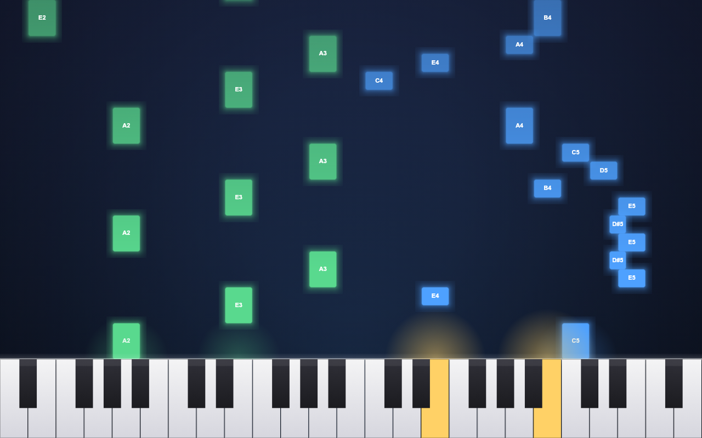
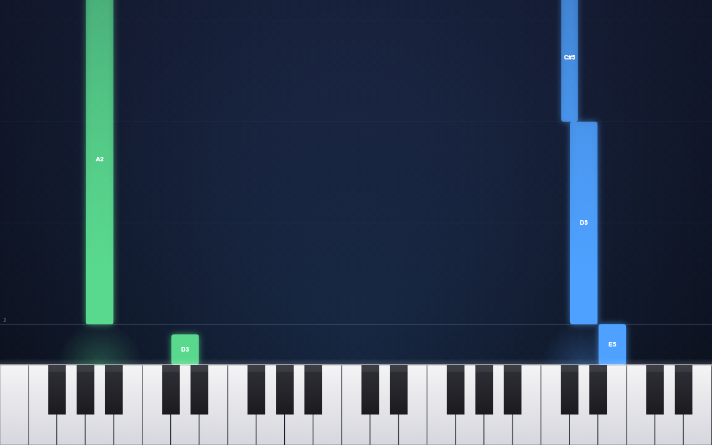
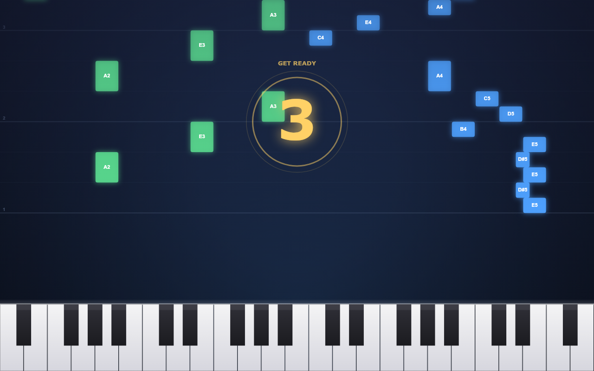
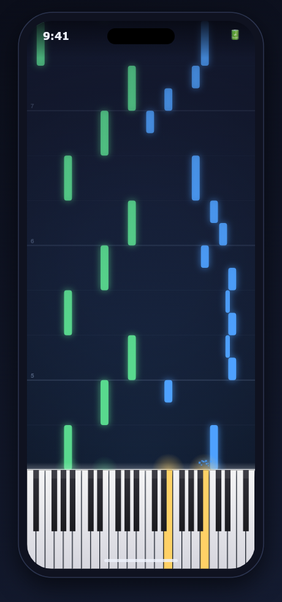

<div align="center">


# 🎹 PianoFlow

**Open-source, Synthesia-style falling-notes piano trainer.**
**开源「下落音符」钢琴练习应用（Synthesia 风格）。**

[](https://github.com/Chmodpuppets/pianoflow/actions/workflows/ci.yml)
[](https://github.com/Chmodpuppets/pianoflow/actions/workflows/pages.yml)
[](https://github.com/Chmodpuppets/pianoflow/releases/latest)

**[▶ Live demo 在线试玩](https://chmodpuppets.github.io/pianoflow/)** ·
**[⬇ macOS app 桌面下载](https://github.com/Chmodpuppets/pianoflow/releases/latest)** ·
**[📖 Full guide 完整文档](docs/GUIDE.md)**

[中文](#中文) · [English](#english)

</div>

---

## 📸 Screenshots · 截图

| 🎮 Falling notes · 下落音符 | ⚡ WebGL GPU rendering · GPU 渲染 |
|:---:|:---:|
| [](docs/img/playfield.png) | [](docs/img/playfield-gpu.png) |
| 🎹 Hand assist · 单手辅助 | 🎉 Combo celebration · 连击庆祝 |
| [](docs/img/playfield-assist.png) | [](docs/img/playfield-milestone.png) |
| 🎼 Dense scores · 密集谱（巴赫） | 🎵 Canon in D · 卡农 |
| [](docs/img/playfield-prelude.png) | [](docs/img/playfield-canon.png) |
| 📜 Scrolling sheet · 滚动五线谱 | 🖨 Printable score · 整谱导出 |
| [](docs/img/sheet.png) | [](docs/img/sheet-page.png) |
| 📊 Practice review · 练习复盘 | ⏱ Visual count-in · 视觉倒数 |
| [](docs/img/review.png) | [](docs/img/playfield-countin.png) |

<div align="center">

### 📱 Installable PWA · 可安装到手机



Add to Home Screen for a full-screen, offline practice app.
添加到主屏幕，即可全屏离线练习。

</div>

---

## 中文

**PianoFlow** 是一个开源的 Synthesia 风格钢琴练习应用：音符下落、真实钢琴音色、MIDI 键盘 / 电脑键盘输入、即时评分。浏览器即开即玩，也有原生 macOS 桌面版。

### 亮点
- 🎮 **下落音符舞台** — 双手分色、键盘自动适配音域、节奏网格、视觉倒数。
- ⚡ **WebGL GPU 渲染** — 实例化单次绘制数千音符，无 WebGL 时自动回退 Canvas2D。
- 🎹 **练习模式** — 单手辅助（另一只手自动弹奏）、逐小节复盘 + 弱项跳转、评分与成就、清空可撤销。
- 📜 **五线谱** — 滚动大谱表 + 可打印整谱 PNG 导出，八分/十六分音符自动符杠。
- 🎵 **12 首内置公版曲目** — 致爱丽丝、卡农、巴赫前奏曲、奇异恩典等。
- 🎤 **真实音色** — 4 种离线 SoundFont（钢琴/电钢/音乐盒/颤音琴）。
- 🌐 **双语界面** — English / 中文 一键切换，曲目名与作者也本地化。
- 📦 **PWA + 桌面** — 可安装、离线可用；Tauri 原生 macOS 应用。

### 快速开始
```bash
pnpm install
pnpm dev        # http://localhost:5173
pnpm tauri:build  # 原生 macOS .app（需 Rust）
```
更多细节见 [完整文档](docs/GUIDE.md)。

---

## English

**PianoFlow** is an open-source, Synthesia-style piano practice app: falling notes, real piano
sound, MIDI / computer-keyboard input and instant scoring. Runs in the browser, with a native
macOS desktop build.

### Highlights
- 🎮 **Falling-notes stage** — color-coded hands, auto-fit keyboard, rhythm grid, visual count-in.
- ⚡ **WebGL GPU rendering** — one instanced draw call for thousands of notes; Canvas2D fallback.
- 🎹 **Practice mode** — hand assist (app plays the other hand), per-measure review + focus chips, scoring & achievements, undoable clears.
- 📜 **Sheet music** — scrolling grand staff + printable full-score PNG export, with beamed eighth/sixteenth notes.
- 🎵 **12 bundled public-domain songs** — Für Elise, Canon in D, Bach Prelude, Amazing Grace…
- 🎤 **Real sound** — 4 offline SoundFonts (piano / e-piano / music box / vibraphone).
- 🌐 **Bilingual UI** — English / 中文, one tap; song titles & composers localized too.
- 📦 **PWA + desktop** — installable & offline; native Tauri macOS app.

### Quick start
```bash
pnpm install
pnpm dev        # http://localhost:5173
pnpm tauri:build  # native macOS .app (requires Rust)
```
See the [full guide](docs/GUIDE.md) for details.

---

<div align="center">

GPL-3.0 · Independent open-source project, **not** affiliated with Synthesia LLC.
GPL-3.0 · 独立开源项目，与 Synthesia LLC 无关联。

</div>
